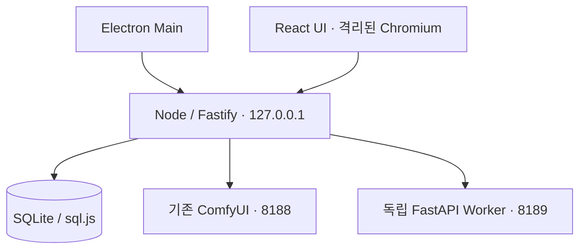

# 아키텍처

## 책임

Electron이 Node 제어 서버의 생명주기를 관리하고 OS 사용자 데이터 경로를 지정한다.
렌더러는 파일 시스템·Node에 직접 접근하지 않는다. 노출할 네이티브 기능이 없어 M0 preload/IPC는 없다.
브라우저와 Electron은 같은 HTTP 계약 및 React 빌드를 사용한다.
ComfyUI/Worker는 사용자가 별도로 실행한다. 자동 프로세스 관리와 설치는 후속 단계다.

`server/settings.ts`는 입력 검증, `store.ts`는 영속성, `comfy.ts`는 외부 로컬 서비스 어댑터,
`app.ts`는 HTTP 계약, `generation/`은 그래프·ComfyUI HTTP/WS·작업 생명주기·PNG 검증을 담당한다. Python Worker에 GPU 연산 의존성은 아직 없다.

## API 비교 및 선택

| 방식 | 장점 | 비용 | 결정 |
|---|---|---|---|
| Server API | 기존 ComfyUI 직접 연결, 노드/모델/큐 조회 | 릴리스 간 호환 보장 없음 | M0 선택 |
| API v2 + self-hosted Proxy | 버전 계약, SDK, SSE | 별도 Proxy 프로세스, 로컬 관리 표면 차이 | 향후 실행 어댑터 검토 |
| Cloud v1 | 기존 클라우드 연동 | 외부 서비스/인증, deprecated | 사용 안 함 |

공식 출처: [API 비교](https://docs.comfy.org/development/run-workflows/overview),
[로컬 서버 경로](https://docs.comfy.org/development/comfyui-server/comms_routes).
M1은 API 형식 JSON, client_id/prompt_id 기반 이벤트 연계와 history 결과 수집을 구현한다.
React는 인증된 API를 폴링하며 Node가 ComfyUI WebSocket을 관리한다.

## 버전 선택

Node 24 LTS / Electron 43.8.1 / React 19.2 / TS 5.9.3 / Vite 7.3.7.
Electron은 44 최신 메이저 대신 이전 안정 메이저의 패치 버전을 사용했다.
Vite 7은 Tailwind 4.1 및 React plugin 4.7 peer 범위와 호환된다.
Fastify 5.12.7과 static 10.1.6은 통합 빌드 및 테스트로 검증한다.
sql.js 1.15.1은 네이티브 ABI 재빌드가 없는 SQLite WASM 구현이다.
검증된 정확한 의존성 트리는 package-lock.json 및 worker/requirements-lock.txt를 기준으로 한다.
Windows/RTX 호환성까지 검증했다는 의미는 아니다.

M2의 `src/prompt.ts`는 순수한 문서 스키마/규칙 compiler이며 UI와 서버가 같은 계약을 사용한다.
PromptEditor는 제어형 입력이고 App 부모의 페이지별 초안을 사용한다. PromptStudio는 인증된 snapshot
저장/조회/삭제를 제공한다. 세대별 LLM/영상 adapter는 아직 실행 구현하지 않았다.
