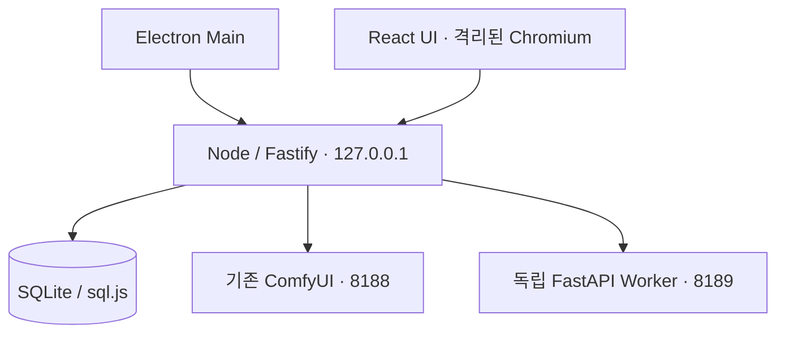

# 아키텍처

## 책임

Electron이 Node 제어 서버의 생명주기를 관리하고 OS 사용자 데이터 경로를 지정한다.
렌더러는 파일 시스템·Node에 직접 접근하지 않는다. 노출할 네이티브 기능이 없어 M0 preload/IPC는 없다.
브라우저와 Electron은 같은 HTTP 계약 및 React 빌드를 사용한다.
ComfyUI/Worker는 사용자가 별도로 실행한다. 자동 프로세스 관리와 설치는 후속 단계다.

`server/settings.ts`는 입력 검증, `store.ts`는 영속성, `comfy.ts`는 외부 로컬 서비스 어댑터,
`app.ts`는 HTTP 계약, `generation/`은 그래프·ComfyUI HTTP/WS·작업 생명주기·PNG 검증을 담당한다. `server/analysis.ts`는 인증된 이미지 분석 프록시, `worker/analysis.py`는 입력/동시 실행 제한,
`worker/adapters.py`는 선택형 Florence/WD14 CPU 추론을 담당한다. GPU 추론 경로는 아직 없다.

## API 비교 및 선택

| 방식 | 장점 | 비용 | 결정 |
|---|---|---|---|
| Server API | 기존 ComfyUI 직접 연결, 노드/모델/큐 조회 | 릴리스 간 호환 보장 없음 | M0 선택 |
| API v2 + self-hosted Proxy | 버전 계약, SDK, SSE | 별도 Proxy 프로세스, 로컬 관리 표면 차이 | 향후 실행 어댑터 검토 |
| Cloud v1 | 기존 클라우드 연동 | 외부 서비스/인증, deprecated | 사용 안 함 |

공식 출처: [API 비교](https://docs.comfy.org/development/run-workflows/overview),
[로컬 서버 경로](https://docs.comfy.org/development/comfyui-server/comms_routes).
M1은 API 형식 JSON, client_id/prompt_id 기반 이벤트 연계와 history 결과 수집을 구현한다.
React는 인증된 API를 폴링하며 Node가 ComfyUI WebSocket을 관리한다.

## 버전 선택

Node 24 LTS / Electron 43.8.1 / React 19.2 / TS 5.9.3 / Vite 7.3.7.
Electron은 44 최신 메이저 대신 이전 안정 메이저의 패치 버전을 사용했다.
Vite 7은 Tailwind 4.1 및 React plugin 4.7 peer 범위와 호환된다.
Fastify 5.12.7과 static 10.1.6은 통합 빌드 및 테스트로 검증한다.
sql.js 1.15.1은 네이티브 ABI 재빌드가 없는 SQLite WASM 구현이다.
검증된 정확한 의존성 트리는 package-lock.json 및 worker/requirements-lock.txt를 기준으로 한다.
Windows/RTX 호환성까지 검증했다는 의미는 아니다.

M2의 `src/prompt.ts`는 순수한 문서 스키마/규칙 compiler이며 UI와 서버가 같은 계약을 사용한다.
PromptEditor는 제어형 입력이고 App 부모의 페이지별 초안을 사용한다. PromptStudio는 인증된 snapshot
저장/조회/삭제를 제공한다. 선택형 LLM은 후속 범위이며 영상 adapter는 M5에 추가했다.

M3 AnalysisStudio는 페이지 이동에도 mounted 상태를 유지한다. 순수 analysis.ts에서 잠금/진행 중 수정값을 병합하고 M2 최종 문서로 변환한다.
모델 폴더는 Worker CLI, 인증 파일은 Node 데이터 폴더에 속한다. 업로드와 분석 원문은 메모리에서만 유지한다.

## M4 Krea

src/krea.ts는 입력·프리셋·진단 계약, server/generation/krea.ts는 공식 노드 그래프 어댑터다. KreaStudio는 전용 편집/진단 화면이며 AnalysisStudio의 전달 대상을 공유한다. SD와 GenerationManager/JobCard/PNG/artifacts 수명주기를 공유하고 한 번에 한 작업만 추적한다. 모델/노드/라이선스와 실제 하드웨어 검증 범위는 KREA_SYSTEM.md에 명시한다.

## M5 영상

server/video는 제한된 FFmpeg/ffprobe subprocess·입력 검증·업로드 API를 담당한다. generation/video는 native Wan 그래프, video-output은 원본준비와 MP4/PNG출력검증을 담당하며 기존 GenerationManager의 단일잠금·취소·복구를 공유한다. VideoStudio 초안은 App에 보존되고 JobCard는 인증된 blob MP4/PNG를 표시한다. 파일은 서버UUID로보관하며 SQLite v4 media_inputs가 원본메타데이터를 유지한다. FFmpeg는 PATH의외부프로그램이며 Worker와별도로실행한다.

## M6 음성

Node가 기존 GenerationManager 잠금 아래 개별 Python 음성 프로세스를 소유한다. Chatterbox(Python 3.11)와 RVC(Python 3.10)는 NumPy/Torch 충돌을 피하기 위해 각각 독립 환경을 사용한다. `/api/voice`는 프로필과 PCM 오디오를 관리하고, SQLite v5에 `voice_profiles`/`audio_sources`를 추가한다. `audio/`는 입력, `voice-work/`는 작업 임시 파일, `outputs/`는 검증된 WAV/MP3를 저장한다. 엔진은 로컬 파일만 사용한다. 상세 설정과 실제 추론 미검증 조건은 [음성 시스템](VOICE_SYSTEM.md)을 참조한다.

## M7 models / library

`server/models`는 명시적으로 등록한 모델의 소유권·해시·작업 기록, 공개 HTTPS 다운로드, Git 노드 검토·활성화를 담당한다. DB v6은 기존 테이블을 유지하며 model_assets/model_tasks/model_config/node_packs/library_marks/model_removals를 추가한다. model_removals는 파일 삭제 전 의도를 저장하고 삭제 후 메타데이터 확정 실패를 재시작/재요청으로 복구한다. GenerationManager의 공유 maintenance 잠금으로 앱 내부 생성·모델 변경·VRAM 요청을 직렬화한다. 외부 Comfy 클라이언트와는 분산 잠금을 제공하지 않는다. `server/library.ts`는 전체 저장 작업에 대한 SQL 필터·페이지·즐겨찾기를 노출하고 기존 JobCard와 재사용 계약을 유지한다. `/free` 응답은 요청 접수이며 GPU 해제 완료 측정과 구분한다.
